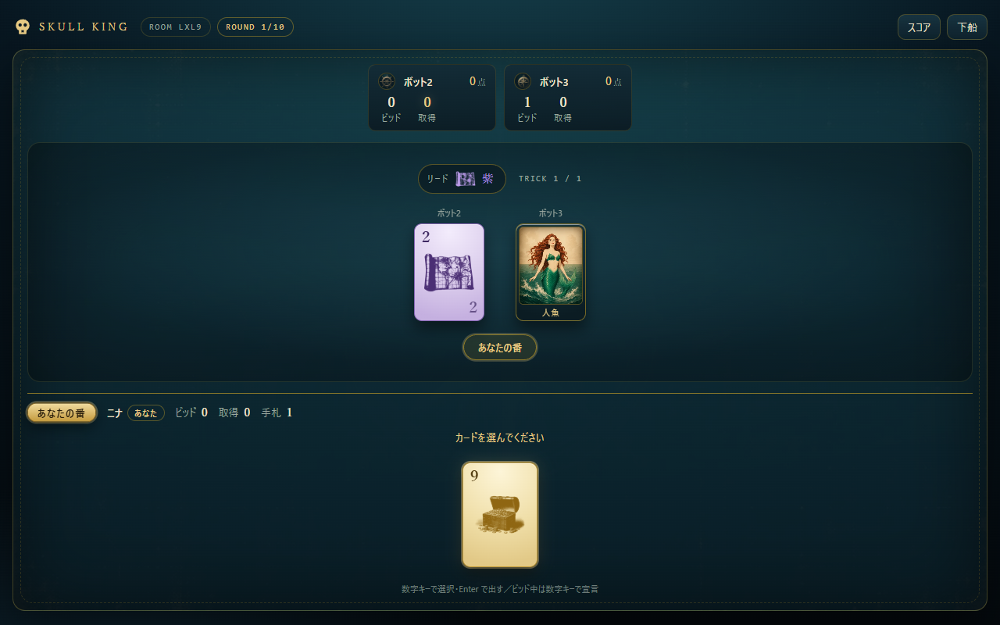
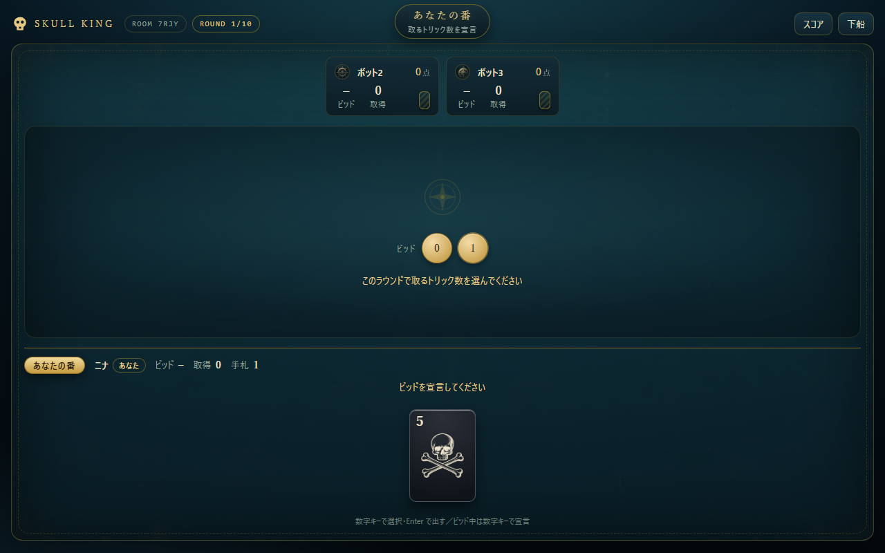
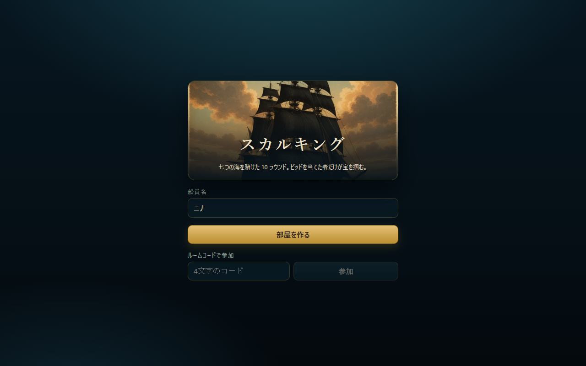
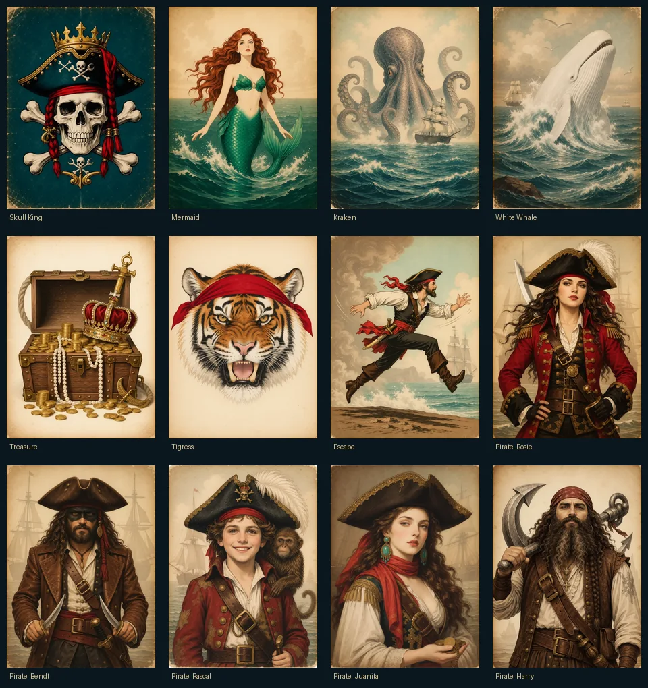
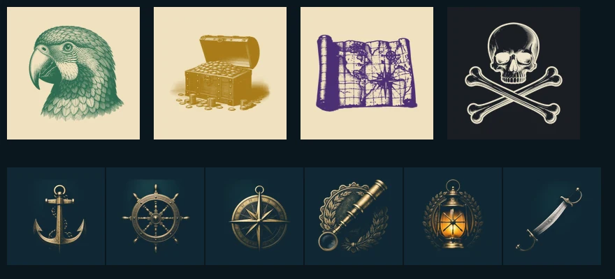

# スカルキング オンライン

スカルキング（Skull King）のオンライン対戦実装です。ルームコードを共有して 2〜6 人で遊べます。1 人でもボットを混ぜて遊べます。

## 動かす

必要なもの: Node.js 22 以上（Node 24 で動作確認）

```bash
npm install
npm start
```

`http://localhost:8123` を開きます。`npm start` はエンジン・プロトコル・画面をビルドしてからサーバーを起動します。

開発中は次の形が便利です。1 つ目のターミナルで `npm run dev:web`（画面を変更のたびに再ビルド）、2 つ目で `npm run dev:server` を起動し、ブラウザを再読み込みします。

```bash
npm run dev:web
npm run dev:server
```

ポートを変えたいときは `PORT=9000 npm start`。

Render などの無料プランは無通信が 15 分続くとスリープします。画面を開いている間だけ 5 分おきに `/api/keepalive` を叩き、対戦中に落ちにくくしています（タブが見えていない間は止めます）。誰も見ていない時はスリープさせて無料枠を無駄にしない方針です。ヘルスチェック用に `/api/health` もあります。

## 遊び方







1. 船員名を入れて「部屋を作る」を押すと、4 文字のルームコードが出ます。
2. 友だちはそのコードを入れて「参加」します。足りない席は「ボットを乗せる」で埋められます。
3. 船長が「出航する」を押すと 10 ラウンドの対戦が始まります。

各ラウンドは「ビッド → トリック → 得点計算」の繰り返しです。ビッドは全員分が揃うまで互いに見えません。手札のうち出せないカードは暗く表示されます。

ラウンドが変わるときと自分の手番になったときは、画面中央に短いバナーが出ます。自分の手番の間は手札の上に「あなたの番」の札が点き、ビッド中は金貨が光って「取るトリック数を選んでください」と案内します。待っている間は「◯◯ のビッド待ち」「◯◯ の番です」と相手の名前が出ます。

場の上には「リード ○○」とスートの絵が大きく出て、トリックを取った人は「獲得 ◯◯」の帯で示されます。各プレイヤーのパネルにはビッドと取得数が並ぶので、誰が何を宣言して何を取ったかが一目で分かります。

- 手札は数字キーで選んで Enter でも出せます（ビッド中は数字キーがそのまま宣言になります）。
- 右上の「ルール」で簡易ルールをいつでも確認できます（ホーム画面の下にも「ルールを見る」があります）。
- 右上の「スコア」でラウンドごとの履歴を開けます。
- ラウンド結果は、接続中の人が全員「次のラウンド」を押すと進みます。押した人には「準備OK」の印が付き、待っている間は残りの人数（準備完了 1 / 2 人）が出ます。ボットと切断中の席は待ちません。
- ラウンド結果の「ボーナス」列には、14・黒14・人魚捕獲・海賊捕獲・王捕獲・略奪品の内訳が付きます。ビッドを外したときは、取れていたボーナスが取り消し線で出ます。
- 効果音（手番・ビッド・カード・トリック獲得・ラウンド終了）は右上の「音 ON / OFF」で切り替えられます。設定はブラウザに保存されます。
- 対戦中にタブを閉じても席は残ります。開き直すと自動で復帰します。誰かが戻ってこない間は、その人の手番で待ちます。

## 構成

```
packages/engine    ルールエンジン（純粋関数・依存なし・Node のテストで検証）
packages/protocol  クライアントとサーバーが共有するメッセージ型
apps/server        HTTP + WebSocket サーバー、ルーム管理、ボット
apps/web           ブラウザ画面（preact + htm）
apps/web/assets     生成したカードイラスト（WebP）
docs/rules.md      実装の正としたルール仕様（判定表・得点表・決定事項）
```

## イラスト





カードの絵はローカルの ComfyUI（MOSS SFT int8 + masterpiece LoRA、832×1152）で生成し、320×410 の WebP にして [apps/web/assets](apps/web/assets) に置いています。特殊カードは生成イラスト、色札（1〜14）は生成したスート絵（羽根・宝箱・海図・ドクロ）を CSS マスクとして色ごとに染めています。ホームの帆船、卓の質感、ロビーの席エンブレム（錨・舵輪・羅針盤・望遠鏡・ランタン・カトラス）、ファビコンも同じ経路で生成したものです。差し替えるときは同じファイル名で上書きして `npm run build -w @skulking/web` を流すだけで反映されます。

- **サーバーが唯一の正**: クライアントは自分の手札・公開情報を含むビューだけを受け取り、他人の手札は枚数しか送られません。ビッドも全員分が揃うまで伏せます。
- **決定的なエンジン**: 乱数はシードから再現できます。テストでは同じシードなら同じ配布になることを確認しています。
- **バンドラなし**: 画面は TypeScript を `tsc` で素の ES モジュールに変換し、`preact` と `htm` は import map で読み込みます。ビルドは `tsc` だけで完結します。

## テスト

```bash
npm test                                                 # エンジンの 44 テスト（裁定表・得点・ランダム通し対戦）
node apps/server/scripts/smoke.mjs                       # サーバー通し確認（要: 起動中のサーバー）
```

`npm run typecheck` で全パッケージの型チェックができます。

## いま入っているルール

基本ルール（70 枚）に対応しています。色カード 56 枚、海賊 5 枚、ティグレス、スカルキング、人魚 2 枚、逃走 5 枚。

- マストフォロー、黒の切り札、特殊カードの強弱（海賊 > 人魚 > スカルキング > 海賊 の循環を含む）
- 逃走リード時に次の色カードがリードスートになる
- 14 のボーナス、人魚・海賊・スカルキングの捕獲ボーナス（ビッド失敗時は没収）
- 0 ビッドの得点

ロビーで拡張カードを個別に ON にできます（74 枚）。クラーケン（トリックが流れる）、白クジラ（特殊カードが勝てない）、略奪品（取った人と出した人が両方ビッド成功で +20）。

細かい解釈は [docs/rules.md](docs/rules.md) に決定事項として残しています。

## 未対応

- 海賊 5 種の能力（ロージー、ベント、ラスカル、ファニータ、ハリー）
- 途中で切断した人の席をボットが代行する仕組み（いまは再接続を待ちます。観戦・タイマーもなし）
- 対戦履歴の保存（サーバーはメモリ上にのみ保持し、全員が抜けて 3 時間で消えます）
